# BetterCheats -- StarRupture Plugin

In-game cheat menu for [StarRupture](https://store.steampowered.com/app/1631270/StarRupture/), built on the StarRupture ModLoader. Settings are saved per save.

**Target:** Game client only

---

## What It Does

Open it with **Esc** → **BETTER CHEATS**, or press **F10**, the shortcut (rebindable in the loader's keybind settings). **Esc** or **Q** closes it (not rebindable). The pages work only in a `ChimeraMain` world, single player or with `EnableCheatsInMultiplayer` on; elsewhere the window says so. Locks and overrides are enforced every engine tick, menu open or not. Power edits are applied on Apply and on save load.

Pages are grouped World, Player, Enemies and Machinery. Teleport, Crafters, Rail Drones and Misc are empty placeholders, and Logistic Drones points to `BetterDrone.ini`.

Most settings are one row: label, live value (what the game uses now; red when it differs from your setting; **+buff** tag and a Base / Mods / Ours / Result tooltip), slider, typed box, **-/+** and a reset icon. A value that differs from its default is applied; reset turns it off. Multipliers act on base stats, attachments and buffs still add on top.

### Saved Presets <sup>[✦](#msantoro12)</sup>

Power, Self, Inventory (Item Stack Sizes only), Movement, Skills, Tools and each weapon tab have a **Saved Presets** row: pick one to load it, **Save** stores the page's settings, **Rename**, **Delete** (asks first).

- Save names it `<built-in> Custom` or `Custom`, made unique. Built-in names are reserved.
- Up to 16 are listed per page.
- Stored in `Plugins\config\BetterCheats-Presets.ini`, shared by every save.

---

## World

### Environment

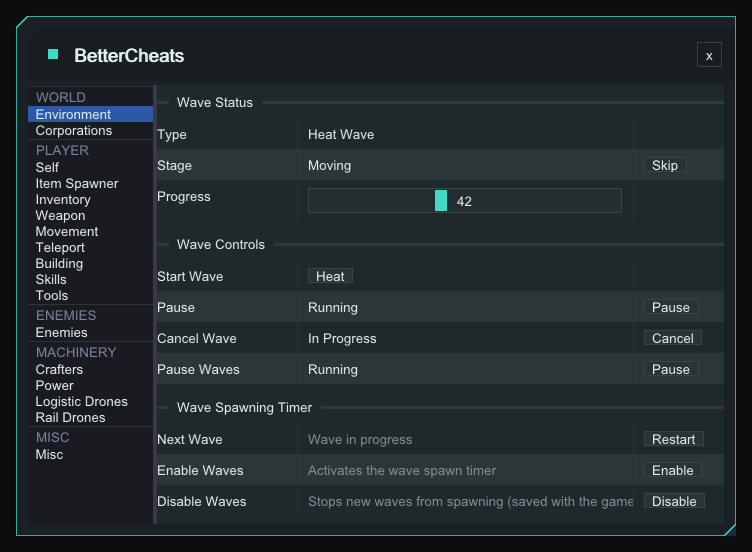

Watch and steer the heat wave. **Skip** force-advances the current stage; **Pause Waves** pins the timer so the next wave never arrives, menu open or not.

- **Cancel** ends the wave in progress, resets the Next Wave countdown and re-enables waves.
- **Restart** re-arms the countdown and re-enables waves, for a rupture that never arrives after loading a save. The Next Wave readout shows m:ss, or the wave, disabled or stalled state.
- **Enable** / **Disable** switch the wave spawn timer on or off, saved with the game.

### Corporations

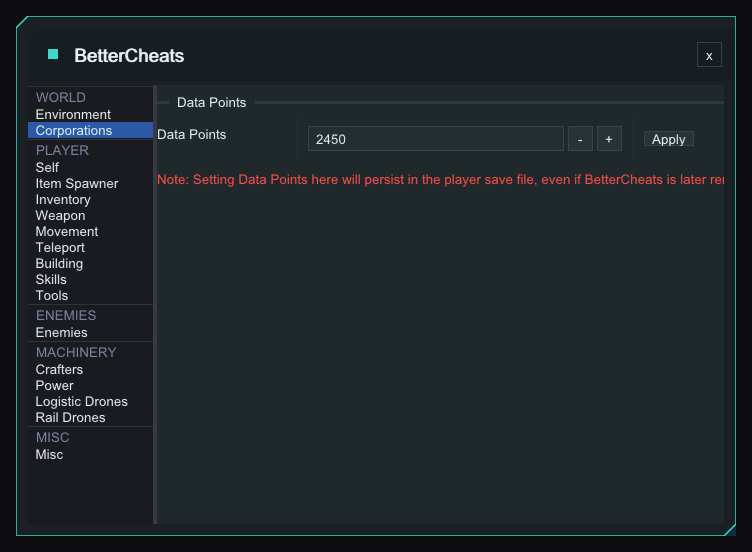

Set your **Data Points** (0 or more) and press **Apply**. Stored in the save, so it stays even if BetterCheats is removed.

---

## Player

### Self

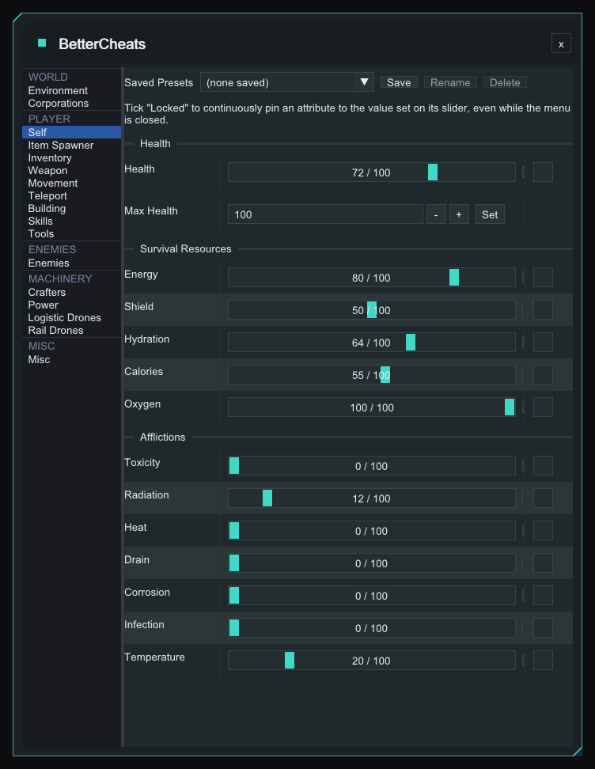

Tick **Locked** and an attribute is held at its slider value, even with the menu closed. Each group has a button beside the sliders: **Full Heal**, **Fill** (survival resources) or **Clear** (afflictions). **Max Health** has a **Set** button that sets Max and current Health. Locks and Max Health are saved per save.

### Item Spawner

Search the item list (icon, name, stack size), set **Stacks** (1 or more) and press **Give Item**. You get stacks x stack size, shown as `xN (stack S)`. The page says so if the game build doesn't expose what it needs.

### Inventory

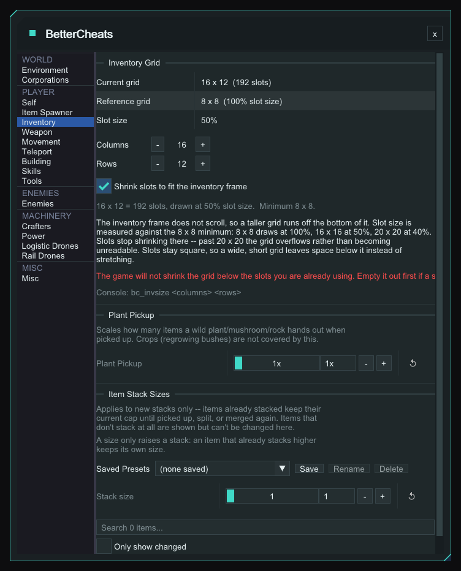

Set the grid to any **Columns x Rows** from 8 x 8 to 40 x 40, saved per save. The same works from the console with `bc_invsize` (see Console).

- The game won't shrink below slots in use, so empty it first.
- **Shrink slots to fit the inventory frame** (on by default) scales slots against 8 x 8 (100%): 16 x 16 is 50% and 20 x 20 is 40%, the floor. The frame doesn't scroll, so larger grids overflow.

#### Plant Pickup <sup>[✦](#msantoro12)</sup>

A whole-number multiplier, 1x to 5x (default 1x), on what a wild plant, mushroom or rock gives when picked up. Crops (regrowing bushes) are not covered.

#### Item Stack Sizes <sup>[✦](#msantoro12)</sup>

Raises stack caps from 1 to 9999 as one global value, per category (Combat, Resource, Consumable, Story Item, Alien Item, Valuable, Gem, Uncategorized, Empty Item, Blueprint Item, Other) or per item, with a search box and **Only show changed**.

- Item beats category beats global; a global of 1 is off.
- New stacks only: existing stacks keep their cap until picked up, split or merged.
- Raise-only: an item that already stacks higher keeps its size.
- Non-stacking items are shown but locked.

### Weapon <sup>[✦](#msantoro12)</sup>

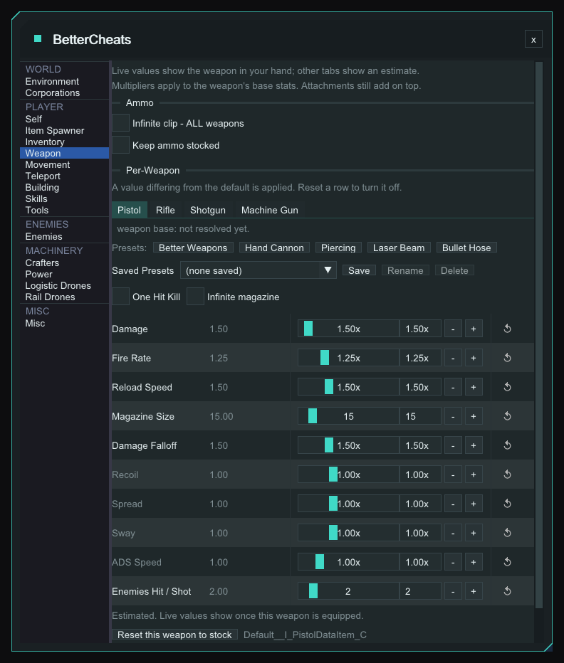

Tabs for **Pistol**, **Rifle**, **Shotgun** and **Machine Gun**; any other weapon or grenade gets a tab when first equipped. Live values show the weapon in your hand, other tabs an estimate. The shot shows the **Better Weapons** preset applied to the Pistol.

- **Infinite clip - ALL weapons**: the clip stays full, no reload, reserve never drawn.
- **Keep ammo stocked**: tops up the equipped weapon's own ammo type with the shortfall. You still reload. Off by default.
- **Keep it out of my inventory**: on by default, stocks the hidden inventory so no slot is used. Untick it if reloads can't draw from it.
- **Clips to keep in reserve**: 1-100, default 3. A live line shows `clip x/y reserve x/y` and `[restocking]`.
- Per weapon: **One Hit Kill** (flat 10000x damage, replaces Damage), **Infinite magazine**, and **Reset this weapon to stock**. Magazine Size is a flat -100 to +999 offset; Enemies Hit / Shot is a whole number, 1-10.
- Presets: **Better Weapons**, **Hand Cannon** (pistol only, heavy damage, slow fire), **Piercing** (Enemies Hit 3), **Laser Beam** (no recoil, spread or sway) and **Bullet Hose** (fast fire, +100 magazine, quick reload, tight spread).
- **Grenade tabs** swap the rows for Charge Cost, Max Charges (0 = game default), Min Charge and **Infinite charges**, which tops the count up to max. The **Less Cost Grenade** preset halves Charge Cost. Fuse Time, Blast Radius and Throw Force sit in a **Blast** section shared by every grenade type and are not reset by **Reset this weapon**. Grenade damage can't be changed here.

Better Weapons and Less Cost Grenade are modelled on pak mods Update 2 broke, by axbhub. Hand Cannon and Piercing are modelled on mods by SwiftstepsKR.

### Movement

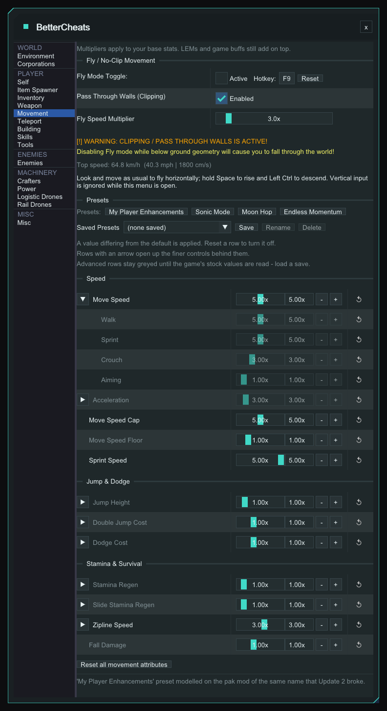

Fly mode (**No Clip**) puts the character in flight. **Space** rises and **Left** or **Right Ctrl** descends (not rebindable; ignored while the menu is open or the game is in the background).

- The **Hotkey** is F9 by default, also rebindable in the loader's keybind settings. Click it, press a key, Esc cancels; Ctrl, Shift and Alt combos work, mouse buttons don't. **Reset** returns F9.
- **Pass Through Walls (Clipping)** is on by default. Turning Fly off inside terrain drops you through the world, so the page shows a red warning while it is on. Off keeps collision.
- **Fly Speed Multiplier** is 1.0-25.0x, default 3.0x, with a Top speed line in km/h, mph and cm/s.

#### Tuning rows and presets <sup>[✦](#msantoro12)</sup>

Each row defaults to 1.00x and an arrow opens finer rows behind it (Move Speed is open in the shot). Speed covers Move Speed, Acceleration, Cap, Floor and Sprint Speed. Jump & Dodge covers Jump Height, Double Jump Cost and Dodge Cost. Stamina & Survival covers Stamina Regen, Slide Stamina Regen, Zipline Speed and Fall Damage (0 removes it).

- The top rows cascade into their finer rows (Move Speed into the four gait speeds, Zipline Speed into Base Speed; Ramp Up, how fast you get up to zipline speed, is its own row); each stays editable afterwards.
- Move Speed Cap and Floor are set directly, not multiplied.
- Finer rows stay greyed until the stock values are read (load a save). The baseline is captured once and saved per save.
- **Reset all movement attributes** clears everything.
- Presets: **My Player Enhancements** (slightly faster, higher jump, cheaper dodge, quicker stamina; recreates the pak mod of the same name that Update 2 broke), **Sonic Mode** (very fast, the one in the shot), **Moon Hop** (low gravity, no fall damage) and **Endless Momentum** (near-free dodge and double jump, fast stamina regen).

### Building

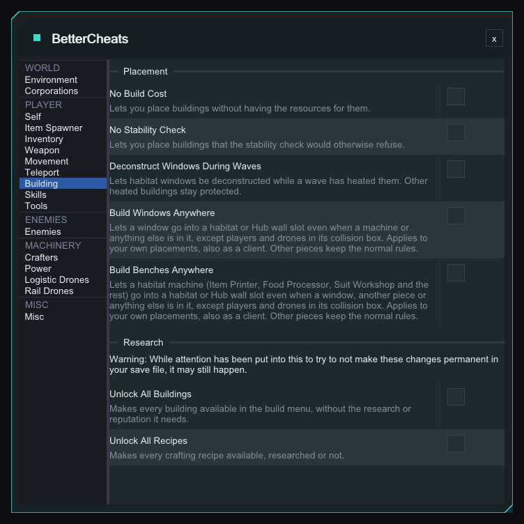

Everything is off by default and saved per save. The Research options sit under a warning that changes may still end up in your save.

- **No Stability Check** also covers zoop and dynamic pillars.
- **Deconstruct Windows During Waves**: lets any of the four window pieces be deconstructed while a wave has heated it. Other heated buildings stay protected. <sup>[✦](#msantoro12)</sup>
- **Build Windows Anywhere**: puts a window into a habitat or Hub wall slot even when a machine or other building is in it. <sup>[✦](#msantoro12)</sup>
- **Build Benches Anywhere**: does the same for Analyzer, Armory, Cloning Bed, Food Processor, Item Printer, Recipe Table, Recycler, Research Terminal, Suit Workshop and Upgrade Station. The game only records that a slot is taken, so a bench can also go into a slot holding a window, airlock, bridge or personal storage. <sup>[✦](#msantoro12)</sup>

The two "anywhere" options relax only the collision check for the piece you place, so the ghost goes green. Your own placements only; in multiplayer they need `EnableCheatsInMultiplayer`. Still refused:

- a player or drone in the collision box;
- a window not snapped to a habitat or the Hub, or into a slot already holding a window, airlock or bridge;
- anything checked separately: stability (unless **No Stability Check** is on), sockets, base-core areas, terrain, resources.

Creatures, characters and plants in the volume are let through only when a building is also there.

### Skills

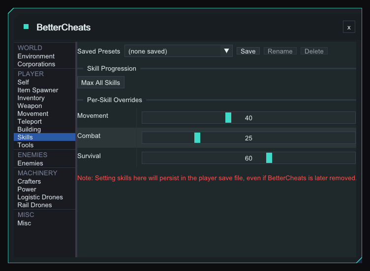

**Max All Skills** sets level 999, XP 0. **Per-Skill Overrides** are sliders from 0 to 100 for Movement, Combat and Survival. Written to the save, so it stays even if BetterCheats is removed.

### Tools

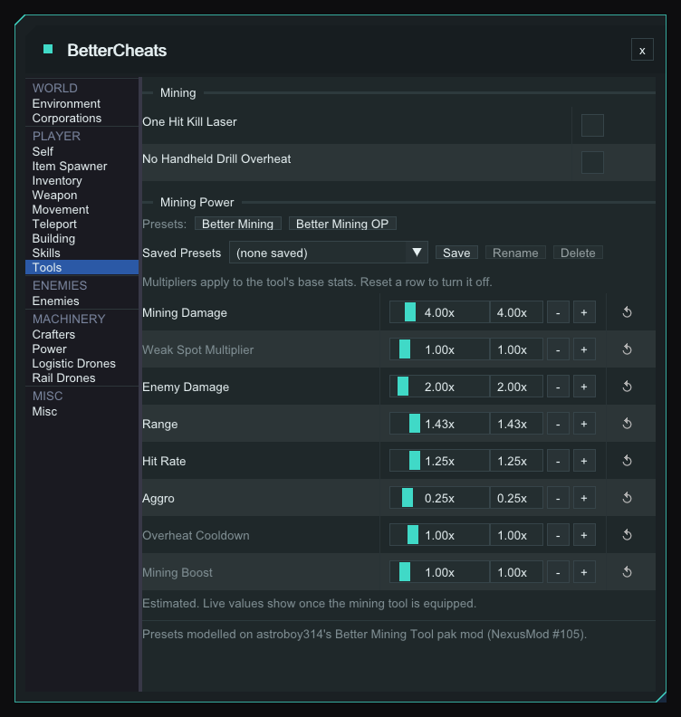

**One Hit Kill Laser** is a flat 10000 mining damage and overrides Mining Damage. **No Handheld Drill Overheat** keeps the handheld drill from ever heating.

- No Handheld Drill Overheat holds the game's own heat-immunity tag while on; a drill that is already hot cools normally. The tag comes off when you switch it off, the world ends or the plugin unloads (loader 1.22.0 or newer; an older loader leaves it on until you respawn).

#### Mining Power <sup>[✦](#msantoro12)</sup>

Eight rows: Mining Damage, Weak Spot Multiplier, Enemy Damage, Range, Hit Rate, Aggro, Overheat Cooldown (lower cools faster) and Mining Boost (raises the max too). Values are estimated until the mining tool is equipped. The presets **Better Mining** and **Better Mining OP** (the one in the shot) are modelled on Better Mining Tool by astroboy314 (Nexus Mods #105). A Tools Saved Presets row also stores both toggles and Mining Boost.

---

## Enemies

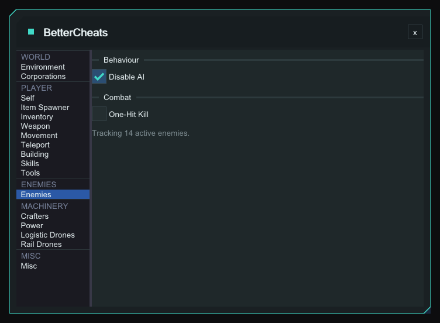

- **Disable AI** stops behaviour-tree ticking and zeroes attack range, so enemies never land a hit.
- **One-Hit Kill** pins every tracked enemy's health to 1, so any hit finishes them.
- The page shows "Tracking N active enemies." Both are saved per save.

---

## Machinery

### Power

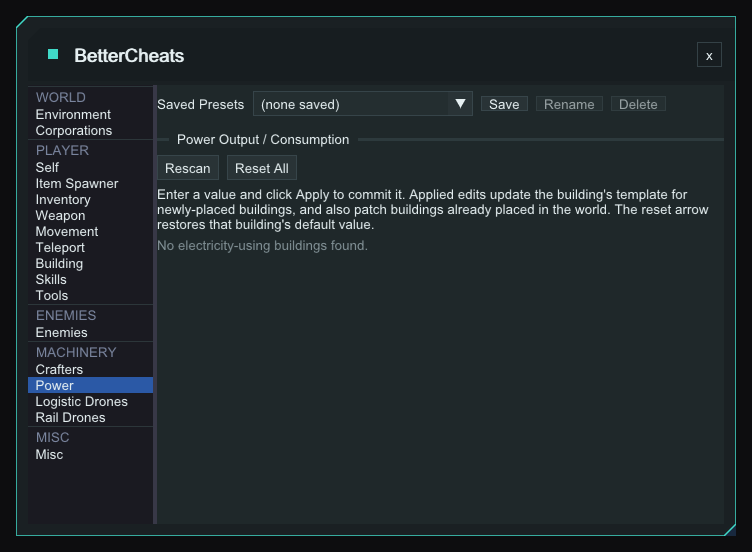

In game, a Producers and a Consumers table list every building, each with a number box, **Apply** and a reset arrow (the tooltip shows the default). Apply updates the template for new buildings and patches placed ones. Saved per save and re-applied by a rescan on load.

---

## Console

Mod console commands:

- `bc_invsize <columns> <rows>` (alias `invsize`) resizes the inventory grid, clamped 8-40. No arguments prints the current grid.

---

## Per-save settings

Toggles, locks and values are saved to `Plugins\BetterCheats\<SessionName>.json` (illegal filename characters become `_`) about a second after a change, and re-applied when the save finishes loading, including on plugin hot-reload. Not saved there: Corporations and Skills (written to the save) and Saved Presets (global).

---

## Configuration

Config is stored in `Plugins\config\BetterCheats.ini` and is generated on first launch.

| Section | Key | Default | Description |
|---|---|---|---|
| `General` | `Enabled` | `true` | `true` or `false` -- enables the plugin |
| `General` | `EnableCheatsInMultiplayer` | `false` | `true` or `false` -- lets the menu open in a multiplayer session. Cheats are not supported in multiplayer and may cause crashes |
| `Menu` | `ToggleKey` | `F10` | Key to open / close the BetterCheats menu |
| `Keybinds` | `NoClipKey` | `F9` | Key to toggle No Clip on / off without opening the menu |

Both keys can be rebound at runtime via the modloader's keybind settings, and the No Clip key from **Player -> Movement**; the change takes effect immediately and is written back to the .ini.

---

## Installation

1. Download the latest release ZIP from the [Releases](../../releases) page: `BetterCheats_Plugin-Client-*.zip`

2. Extract into your game's `Binaries\Win64\ModLoader\` folder. The ZIP contains a `Plugins\` folder, so the DLL lands in `ModLoader\Plugins\`.

3. Launch the game, then press **F10** (default) in-game to open the menu.

> **Requires [StarRupture-ModLoader](https://github.com/AlienXAXS/StarRupture-ModLoader)** to be installed first.

---

## Troubleshooting

- **Menu opens but is empty:** load into a save. In multiplayer, set `EnableCheatsInMultiplayer=true`.
- **Toggle key does nothing:** check the keybind in the modloader settings -- it may have been rebound.
- **Saved cheat settings not restored:** check `modloader.log` for errors loading `Plugins\BetterCheats\<SessionName>.json`.
- **Plugin not loading:** check `ModLoader.log` in `Binaries\Win64\ModLoader\Logs\` for errors.
- **Game updated, plugin broken:** some features use byte-pattern scanning. A game update may shift the patterns -- wait for a plugin update.
- **A Building option does nothing:** **Deconstruct Windows During Waves**, **Build Windows Anywhere** and **Build Benches Anywhere** each need byte patterns to match. If one misses after a game update, the plugin still loads, the option does nothing, and `modloader.log` has a line saying which one.

---

## Building from Source

Requires Visual Studio 2022 and the [StarRupture-Plugin-SDK](https://github.com/AlienXAXS/StarRupture-Plugin-SDK) and [StarRupture-Game-SDK](https://github.com/AlienXAXS/StarRupture-Game-SDK), checked out alongside this repo.

Clone the repo, open `StarRupture-Plugin-BetterCheats.sln`, and build the `Client Release|x64` configuration:

```
msbuild StarRupture-Plugin-BetterCheats.sln /p:Configuration="Client Release" /p:Platform=x64
```

The output DLL is placed in `build\Client Release\Plugins\BetterCheats.dll`.

---

## Disclaimer

This is a single-player cheat menu intended for personal use. Use at your own risk -- the authors are not responsible for any damage caused by using this software, including loss of save data or issues caused by using cheats in multiplayer/server contexts.

---

## Credits

Original mod by [@AlienXAXS](https://github.com/AlienXAXS).

Contributors:

- [@Lorke76](https://github.com/Lorke76)
- <a id="msantoro12"></a><sup>✦</sup> [@msantoro12](https://github.com/msantoro12), creator of [StarRupture Planner](https://starrupture.goodstuff.software)
